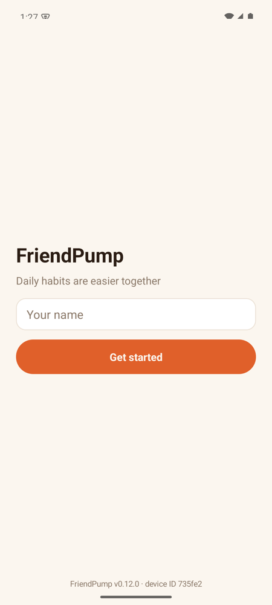
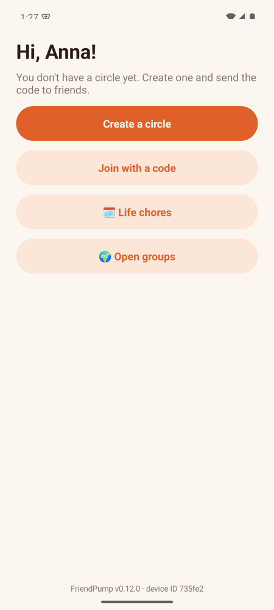
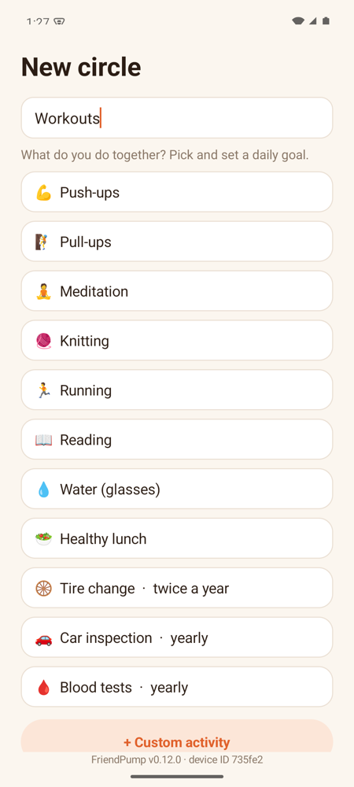
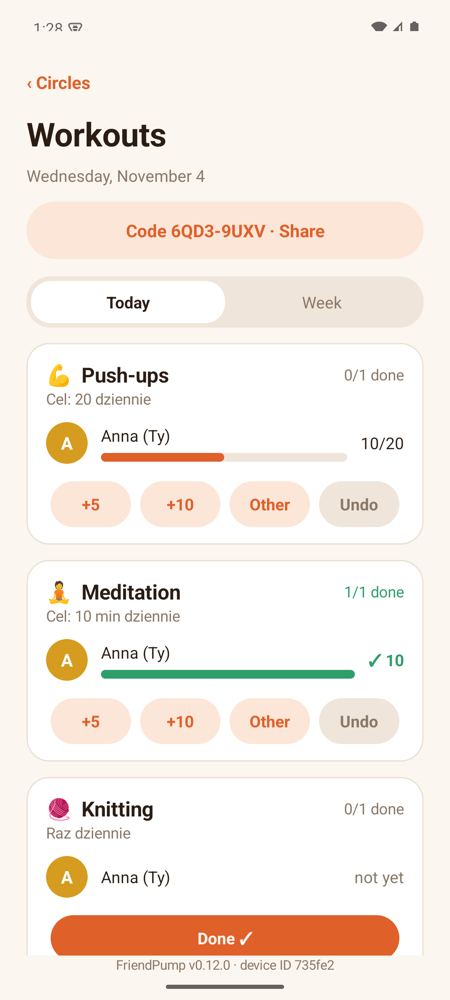
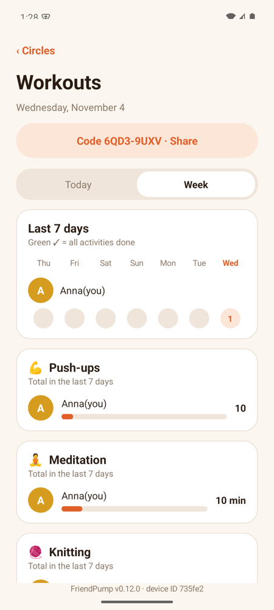

# FriendPump

**Daily habits are easier together.** FriendPump is a small Android app where a few friends join a *circle*, tick off their daily activities (push-ups, pull-ups, meditation, knitting, reading…) and see who has already done their part today.

The point is gentle motivation, not a leaderboard: a friend's green check makes it harder to skip your own.

<p>
  
  
  
  
  
</p>

## Download

**[Download the latest APK](https://github.com/paulcrowski/FriendPump/releases/latest)** (currently v0.12.0, Android 8.0+).

1. Open the link on your phone and download `FriendPump-<version>.apk`.
2. Allow installation from this source when Android asks (one-time).
3. Enter your name and you are in. No e-mail, no password.

Integrity: each release ships a `SHA256SUMS` file next to the APK.

## How it works

- **Circles.** Create a circle ("Workouts"), pick activities and set a daily goal for each. You can belong to several circles.
- **Invite with a code.** Share the circle code (e.g. `ABCD-1234`) through any messenger; friends tap *Join with a code* and paste it.
- **Today.** For every activity you see each member's progress: `+5`, `+10` or a custom amount; *Undo* removes your last entry.
- **Week.** A 7-day grid and totals show who is keeping up.
- **Open groups and Life chores.** Public interest groups anyone can join, and a personal list of recurring things (tire change, car inspection, blood tests).
- **No accounts.** Your phone generates a random secret that acts as your identity; the backend stores only its hash. Every request checks circle membership.

> Note: losing the phone or reinstalling the app loses your identity. A recovery code is on the roadmap.

## Tech

| Layer | Choice |
| --- | --- |
| App | Native Android in plain Java, no libraries, UI built in code |
| Build | `scripts/build-apk.sh` (aapt2 + javac + d8 + apksigner), no Gradle |
| Backend | [Convex](https://www.convex.dev/) called over its HTTP API |
| Tests | Java unit tests + Vitest for Convex functions |

## Build from source

Requirements: Android SDK (build-tools 35.0.0, platform android-35), a JDK, Node.js.

```bash
npm install
npm run lint && npm run typecheck && npm test
npm run build        # produces dist/FriendPump-<version>.apk
```

The APK is signed with a local keystore created in `signing/` on first build (not committed).

To run your own backend, deploy `convex/` to a Convex project and set `BASE_URL` in `app/src/main/java/pl/friendpump/app/Api.java`.

## Project docs

Design notes and the task workflow are written in Polish: [`docs/KONCEPCJA.md`](docs/KONCEPCJA.md) (concept), [`AGENTS.md`](AGENTS.md) (working rules), [`ParkingLot.md`](ParkingLot.md) (ideas for later).

Some in-app strings are still in Polish; full localization is not done yet.
